# 🚀 Iron Man (Tony Stark) — 3D Anime Funko Pop / Nendoroid ChatGPT Pet

<p align="center">
  <a href="https://chatgpt.com/s/sharepet_6ad48e2159088191a19a5b11b898c6c1">
    
  </a>
  
  
  
  
  
</p>

<p align="center">
  <b>A fully validated, production-grade 3D collectible desktop companion of Iron Man (Tony Stark) in stylized Funko Pop / Anime Nendoroid aesthetic for ChatGPT Desktop and Work Mode.</b>
</p>

<p align="center">
  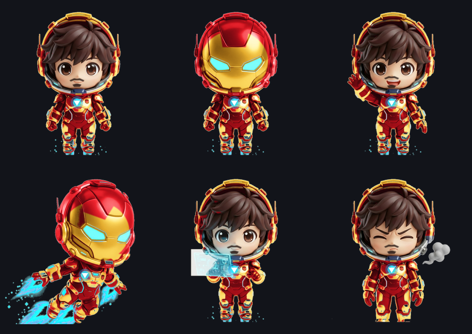
</p>

---

## ⚡ 1-Click Instant Install

Click the badge below to adopt Iron Man directly into your ChatGPT Pets library:

[](https://chatgpt.com/s/sharepet_6ad48e2159088191a19a5b11b898c6c1)

> **Direct URL:**  
> **[https://chatgpt.com/s/sharepet_6ad48e2159088191a19a5b11b898c6c1](https://chatgpt.com/s/sharepet_6ad48e2159088191a19a5b11b898c6c1)**

---

## 🎬 Live Animation Showcase

All 73 frames are hand-tuned and rendered in 3D Octane style with metallic reflections, glow shaders, and dynamic particle effects:

| Animation State | Preview | Description |
| :--- | :---: | :--- |
| **Idle** *(Row 0, 6 frames)* | 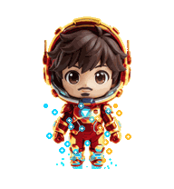 | Subtle breathing hover, visor reflections, arc reactor glow. |
| **Walk** *(Row 1, 8 frames)* | 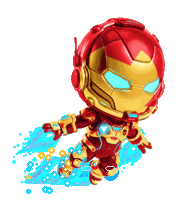 | Pacing across workspace with boot thruster particle trails. |
| **Run / Dash** *(Row 2, 8 frames)* | 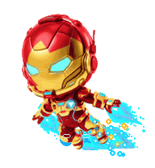 | Full repulsor flight burst across your screen. |
| **Rest / Sit** *(Row 3, 4 frames)* | 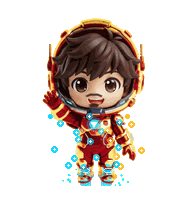 | Landing, visor open, Tony resting in low-power mode. |
| **Thinking** *(Row 4, 5 frames)* | 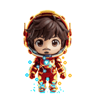 | Active holographic F.R.I.D.A.Y. tactical HUD display. |
| **Action / Work** *(Row 5, 8 frames)* | 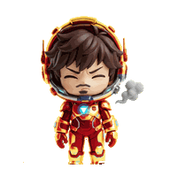 | Repulsor calibration, rapid calculations, nano-tech work. |
| **Success** *(Row 6, 6 frames)* |  | Celebratory victory salute and repulsor flare! |
| **Failure / Error** *(Row 7, 6 frames)* | 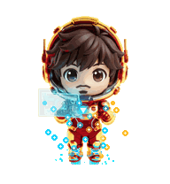 | Armor malfunction, smoke puff, bewildered Tony. |
| **Sleep** *(Row 8, 6 frames)* | 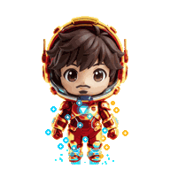 | Deep sleep power-down, arc reactor slow breathing pulse. |
| **Cursor Tracking** *(Rows 9-10, 16 frames)* | 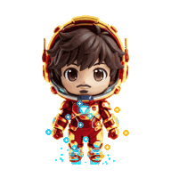 | **360° Real-time gaze tracking** following your mouse cursor! |

---

## ✨ Key Features

* **Standard v2 Compliance**: Exactly `1536×2288 px` (11 rows × 8 columns) with 73 active frames and 15 strictly transparent cells (`alpha == 0`).
* **360° Cursor Tracking**: 16 discrete look angles in 22.5° steps (Rows 9 & 10) dynamically track your mouse cursor across the desktop.
* **Double-Faced Character Art**: Features both the classic Mark 85 closed helmet and the open visor revealing chibi anime Tony Stark.
* **Zero Halo Artifacts**: 100% clean alpha mask (`transparent_rgb_residue_pixels: 0`), preventing compression bleeding or white borders.
* **Dual Compatibility**: Includes both the modern **v2** spritesheet and legacy **v1** (`1536×1872 px`, 9 rows) version for backward compatibility.
* **Lossless WebP & Optimized PNG**: Includes pre-optimized `.png` and `.webp` builds.

---

## 📦 Spritesheet Contact Sheet

<p align="center">
  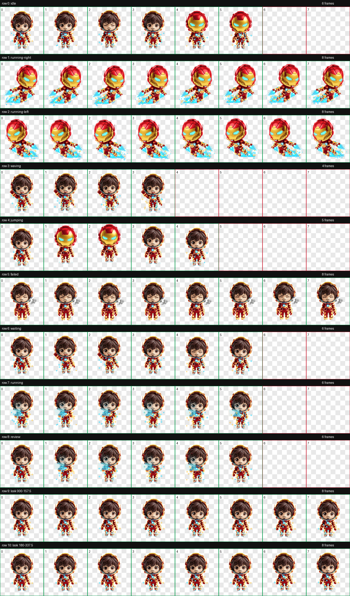
</p>

---

## 🛠️ Manual Installation (Codex / ChatGPT Work Mode)

If you prefer to upload the spritesheet file directly:

1. Download [`assets/ironman_funko_anime_v2_spritesheet.png`](assets/ironman_funko_anime_v2_spritesheet.png).
2. Attach it to your Codex / ChatGPT chat.
3. Paste this prompt:

```text
I have attached the validated v2 ChatGPT Pets spritesheet: ironman_funko_anime_v2_spritesheet.png.
Please perform the following steps byte-for-byte without regenerating the image:
1. Call mcp_codex_apps_pets_validate_pet_spritesheet to verify valid=true (sprite_version=2).
2. Call mcp_codex_apps_pets_prepare_pet_upload to get an upload_session_id.
3. Create or update the pet with name "Iron Man" and description "3D Funko Pop & Anime Nendoroid Iron Man (Tony Stark) with reactive repulsors and v2 cursor tracking".
4. Select the pet to make it active.
```

> For instructions in Russian, see [docs/INSTALL_RU.md](docs/INSTALL_RU.md).

---

## 🔬 Technical Validation & Reports

Both official OpenAI preflight validation and animation continuity checks were passed with zero errors:

* **Validation Report**: [`reports/validation_funko_v2.json`](reports/validation_funko_v2.json) (`ok: true`, 0 errors, 0 warnings)
* **Continuity Report**: [`reports/continuity_funko_v2.json`](reports/continuity_funko_v2.json) (`ok: true`, 0 alpha holes)

### Run the Local Validator

You can test any custom pet spritesheet using the standalone CLI validator included in this repository:

```bash
# Install dependencies
pip install -r requirements.txt

# Validate v2 spritesheet
python scripts/validate_spritesheet.py assets/ironman_funko_anime_v2_spritesheet.png --v2

# Validate v1 legacy spritesheet
python scripts/validate_spritesheet.py assets/ironman_funko_anime_v1_spritesheet.png --v1
```

---

## 📂 Repository Structure

```text
ironman-chatgpt-pet/
├── .github/
│   └── workflows/
│       └── validate.yml          # GitHub Actions CI validating spritesheets on push
├── assets/
│   ├── ironman_funko_anime_v2_spritesheet.png   # Production v2 spritesheet (1536x2288)
│   ├── ironman_funko_anime_v2_spritesheet.webp  # Lossless WebP v2
│   ├── ironman_funko_anime_v1_spritesheet.png   # Legacy v1 spritesheet (1536x1872)
│   ├── ironman_funko_anime_showcase.png         # 3D Render showcase
│   └── ironman_funko_anime_contact_sheet.png    # 11-row contact sheet
├── animations/
│   ├── idle.gif                  # Row 0
│   ├── walk.gif                  # Row 1
│   ├── run.gif                   # Row 2
│   ├── rest.gif                  # Row 3
│   ├── thinking.gif              # Row 4
│   ├── action.gif                # Row 5
│   ├── success.gif               # Row 6
│   ├── failure.gif               # Row 7
│   ├── sleep.gif                 # Row 8
│   └── cursor_tracking.gif       # Rows 9 & 10 (360° gaze)
├── reports/
│   ├── validation_funko_v2.json  # OpenAI preflight report
│   └── continuity_funko_v2.json  # Continuity verification report
├── scripts/
│   ├── validate_spritesheet.py        # Standalone pets validator CLI
│   ├── generate_animations.py         # Slice spritesheet into GIFs
│   └── build_3d_octane_ironman_v2.py  # Master procedural atlas builder
├── docs/
│   ├── PETS_V2_SPECIFICATION.md       # Comprehensive ChatGPT Pets protocol guide
│   └── INSTALL_RU.md                  # Руководство по установке на русском языке
├── requirements.txt
├── LICENSE                            # MIT License
└── README.md
```

---

## 📜 Specification & Standards Reference

For developers designing custom pets, see our complete technical breakdown:  
👉 **[docs/PETS_V2_SPECIFICATION.md](docs/PETS_V2_SPECIFICATION.md)**

---

## ⚖️ Legal & Fair Use Disclaimer

*Iron Man* and *Tony Stark* are registered trademarks of Marvel Characters, Inc. and The Walt Disney Company.  
This repository is a non-commercial, transformative fan-art creation developed for personal customisation of desktop environments under Fair Use.

---

## 📄 License

This project is licensed under the **[MIT License](LICENSE)** — feel free to use the tools, scripts, and specification in your own ChatGPT Pet projects!
